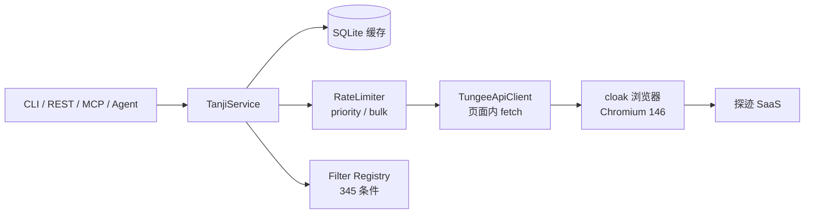

# tanji-client

> 探迹 AI 拓客（sales.tungee.com）的本地客户端：**cloak 浏览器常驻会话 + CLI / REST / MCP / SKILL 四种接口**，统一 envelope、SQLite 缓存、多账号与 systemd 常驻。


## 目录

- [项目简介](#项目简介)
- [架构](#架构)
- [功能](#功能)
- [环境要求](#环境要求)
- [快速开始](#快速开始)
- [使用方式](#使用方式)
- [文档索引](#文档索引)
- [项目结构](#项目结构)
- [开发与测试](#开发与测试)
- [性能与缓存](#性能与缓存)
- [安全与限制](#安全与限制)
- [版本与许可](#版本与许可)

## 项目简介

tanji-client 把探迹网页端的能力封装成本地服务：

- **会话保活**：cloak 浏览器常驻，登录态失效时心跳自动重登；
- **稳定读取**：搜索、翻页、详情、联系人统一走本地 SQLite 缓存；
- **多入口**：命令行（`tanji`）、本地 REST（Bearer）、MCP stdio、agent SKILL；
- **可运维**：systemd user 常驻、多账号、JSONL 日志轮转、本地限频与背压。

> 本项目仅用于用户已授权账号的本地自动化；使用前请自行确认与探迹的服务条款。

## 架构



- 浏览器：共享 `~/cloak-env` FHS + cloakbrowser 0.6.5；
- 缓存：SQLite WAL，cache-aside，TTL + 手动清理；
- 调度：priority（解锁/登录）与 bulk（读）双通道，读队列满返回 429 + `retryAfterMs`；
- 输出：统一 `{ ok, data, meta, error }` envelope，schema v1.0。

## 功能

| 能力 | 说明 |
| --- | --- |
| 登录 | 手机号 + 密码 → SSO → 探迹拓客；验证码场景支持人工兜底 |
| 名称搜索 | 企业名 / 人名 / 地址 / 统一码 / 联系方式 |
| 高级筛选 | 12 类 / 345 个 UI 条件，转换成上游 filter JSON |
| 翻页 | queryId 会话 + 页缓存；名称搜索第 2 页起走 advance-search |
| 企业详情 | 7 个上游接口并行；支持 `sections` 轻量模式（2 个接口） |
| 联系人 | 未解锁返回空；解锁后明文手机/固话/邮箱 |
| 解锁 | 默认 1 个上游调用（priority），可选 `quota` / `contacts` |
| 缓存 | 搜索页 / 详情 / 联系人 / query 会话；TTL + refresh + clear |
| 多账号 | 每账号独立 profile / cache / 端口 / 进程 |
| 常驻 | systemd user（开机自启、崩溃重启）或后台 daemon |
| 观测 | JSONL 日志轮转 + 脱敏、`/v1/health`、`/v1/status` |

## 环境要求

| 项 | 要求 |
| --- | --- |
| OS | Linux；NixOS 通过 FHS 运行 Chromium（见 [部署文档](docs/08-deployment.md)） |
| Node.js | >= 22.5（`node:sqlite`）；本项目验证 22.23.2 |
| 浏览器环境 | 共享 `~/cloak-env`：FHS + cloakbrowser 0.6.5 + Chromium 146 |
| 探迹账号 | 已授权账号；解锁消耗额度 |
| 常驻（可选） | systemd user，或 `tanji accounts start` |

## 快速开始

```bash
# 0) 共享浏览器环境（独立于本仓库）
CLOAK_ENV=$HOME/cloak-env scripts/setup-cloak-env.sh
~/cloak-env/bin/cloak-env-info          # 查看版本

# 1) 安装依赖并构建
npm install
npm run build

# 2) 配置（权限 600）
cp .env.example .env
# 填入 TANJI_PHONE / TANJI_PASSWORD / TANJI_API_TOKEN
# `.env` 会被自动加载（也可用 TANJI_ENV_FILE 指定）
# 或使用 ~/.tanji-client/config.json（见 docs/09-configuration.md）

# 3) 安装全局命令（可选）
ln -sf "$PWD/bin/tanji-run" ~/.local/bin/tanji

# 4) 登录 + 验证
tanji login --interactive       # 首次登录（可见浏览器过验证码）
tanji status                    # 登录态 + 日/月额度
tanji search name --name 团车 --page-size 5
```

## 配置与环境

- 完整字段、环境变量、共享 `~/cloak-env` 初始化：[docs/09-configuration.md](docs/09-configuration.md)
- 单账号模板：[config.example.json](config.example.json)
- 多账号模板：[config.multi-account.example.json](config.multi-account.example.json)
- 环境变量模板：[.env.example](.env.example)
- 筛选条件示例：[examples/filters.example.json](examples/filters.example.json)

```bash
# 初始化共享浏览器环境（NixOS 会构建 FHS）
CLOAK_ENV=$HOME/cloak-env scripts/setup-cloak-env.sh

# 配置
cp config.example.json ~/.tanji-client/config.json
chmod 600 ~/.tanji-client/config.json
```

## 使用方式

### CLI

```bash
tanji --help
tanji health
tanji status
tanji search name --name 团车 --field name
tanji search advance --filter-file filters.json
tanji companies list --query-id <qid> --page 2
tanji companies detail --id <companyId> --sections basic,detail
tanji contacts --id <companyId> --types mobile,email
tanji unlock --id <companyId> --confirm [--with-contacts] [--with-quota]
tanji cache stats
tanji cache clear --all
tanji accounts list
tanji service install
```

所有命令输出统一 envelope；任意命令支持 `--help`，`tanji docs <operationId>` 查看单操作完整说明。

### REST

```bash
tanji serve --port 8787
# 文档
curl http://127.0.0.1:8787/docs
curl http://127.0.0.1:8787/openapi.json
# 状态（Bearer）
curl -H "Authorization: Bearer $TANJI_API_TOKEN" http://127.0.0.1:8787/v1/status
# 企业详情（轻量）
curl -H "Authorization: Bearer $TANJI_API_TOKEN" \
  "http://127.0.0.1:8787/v1/companies/<id>?sections=basic,detail"
```

REST 仅监听 `127.0.0.1`；除 `/v1/health` 与文档页外均需 Bearer token。

### MCP

```bash
tanji mcp
```

暴露 13 个 MCP 工具（health/status/accounts/login/search/list/detail/contacts/unlock/cache/filters）。

### SKILL

Agent 使用说明见 [skills/tanji/SKILL.md](skills/tanji/SKILL.md)。

## 文档索引

| 编号 | 文档 | 内容 | 状态 |
| --- | --- | --- | --- |
| 00 | [需求访谈记录](docs/00-interview.md) | 访谈过程与决策 | 已归档 |
| 01 | [需求文档](docs/01-requirements.md) | PRD、功能与验收标准 | 已归档 |
| 02 | [接口草案](docs/02-api-draft.md) | 早期接口设计 | 已归档（以 06 为准） |
| 03 | [页面操作实录](docs/03-page-operations.md) | 登录/搜索/详情/解锁全链路 | 已归档（已脱敏） |
| 04 | [高级筛选清单](docs/04-filter-catalog.md) | 345 个条件实测清单 | 已归档 |
| 05 | [企业查询实录](docs/05-enterprise-search.md) | “找企业”入口与字段 | 已归档 |
| 06 | [接口规范](docs/06-api-spec.md) | **权威 API 契约** | 现行 v1.0 |
| 07 | [性能与缓存](docs/07-performance-cache.md) | 压测、调度、缓存机制 | 现行 |
| 08 | [部署与常驻](docs/08-deployment.md) | 共享环境、systemd、多账号、排障 | 现行 |
| 09 | [配置与环境](docs/09-configuration.md) | 配置文件、环境变量、共享浏览器环境、排障 | 现行 |
| — | [文档索引](docs/README.md) | 阅读顺序与维护约定 | — |

## 项目结构

```text
.
├── bin/                    # tanji-run / 共享 FHS 入口
├── deploy/                 # fhs.nix + 通用 cloak-run
├── scripts/                # setup-cloak-env.sh
├── examples/               # filter 示例
├── data/                   # filter-registry.json（345 条件）
├── docs/                   # 需求、实录、接口、性能、部署
├── skills/tanji/           # Agent SKILL
├── config.example.json     # 单账号配置模板
├── config.multi-account.example.json
├── LICENSE                 # Unlicense（公共领域）
├── spec/                   # 自动生成的 OpenAPI / MCP / CLI 规范
├── src/
│   ├── adapters/tungee/    # 上游 API、filter 映射、限频
│   ├── api/                # operations + dispatch
│   ├── browser/            # BrowserHost + cloak 实现
│   ├── cache/              # SQLite / memory 缓存
│   ├── config/             # zod 配置与加载
│   ├── domain/             # 领域模型（zod）
│   ├── errors/             # 错误码目录
│   ├── generators/         # zod → JSON Schema / OpenAPI / MCP / CLI
│   ├── session/            # 登录、心跳、单实例锁
│   ├── transports/         # CLI / REST / MCP
│   └── bench/              # 性能基准
└── tests/                  # vitest（51 个用例）
```

## 开发与测试

```bash
npm run typecheck       # tsc 类型检查（src + tests）
npm test                # vitest，51 个用例
npm run gen             # 重新生成 spec/ 与 data/filter-registry.json
npm run gen:check       # 校验生成物是否最新
npm run build           # 输出 dist/
npm run bench           # 性能基准（需真实登录环境）
```

## 性能与缓存

- 缓存命中：REST 层单请求 p50 ≈ **1.7–2.3ms**，单并发 ≈ 420–570 QPS，4 并发 ≈ 1,075 QPS；
- 上游冷读：约 **2–8 QPS**（受探迹响应与限频约束）；
- 生产默认 `TANJI_RATE_PER_MIN=20`；解锁走 priority，批量读不会阻塞解锁；
- 缓存表、TTL、key、refresh、清理与限制见 [07-性能与缓存](docs/07-performance-cache.md)。

## 安全与限制

- **不要提交** `.env`、`~/.tanji-client/config.json`、浏览器 profile、日志、SQLite 缓存；`.gitignore` 已排除。
- REST 默认仅本机监听；`TANJI_API_TOKEN` 必须修改默认值。
- 解锁会消耗额度；默认只打 1 个上游调用，`--with-quota` / `--with-contacts` 才会附加查询。
- 上游页面/接口可能变更；出错会返回 `UPSTREAM_CHANGED`，需要更新适配层。
- 缓存无 LRU；`sort` 未纳入部分缓存 key，`queries` 过期字段未强制校验（见 07 文档“已知限制”）。
- 浏览器环境依赖 cloakbrowser 0.6.5（keyless，Chromium 146）；升级 0.7.x 需要 license key。

## 版本与许可

- 当前版本：`0.1.0`（含 2026-11-10 的调度/解锁/缓存优化）。
- 变更记录：[CHANGELOG.md](CHANGELOG.md)。
- 安全说明：[SECURITY.md](SECURITY.md)。
- **License：[Unlicense](LICENSE)（公共领域，无限制）。**
- 免责声明：本项目的 License 仅覆盖本仓库的代码与文档；使用探迹、CloakBrowser、Chromium 及历史记录中的业务数据时，请自行遵守对应服务条款、授权范围与当地法律。
