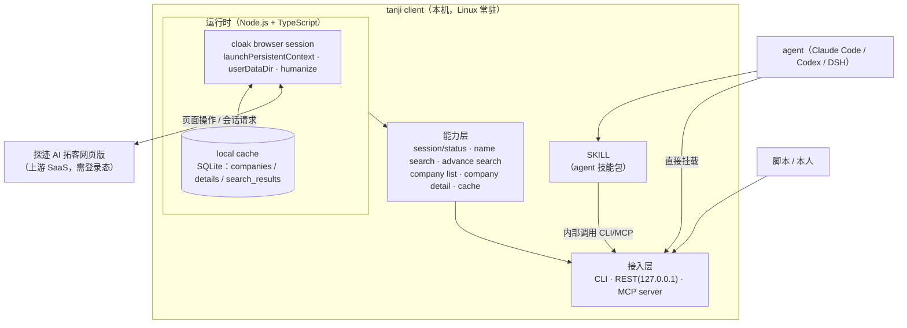

# Tanji Client 需求文档（PRD）
> 文档编号：01 ｜ 状态：v0.1 已归档 ｜ 最后更新：2026-11-10
> 产品需求与验收标准；实现状态以 README/06 为准。


| 项 | 内容 |
| --- | --- |
| 版本 | v0.1（草稿，待评审） |
| 日期 | 2026-11-09 |
| 状态 | 草稿 → 评审中 |
| 关联文档 | [`00-interview.md`](./00-interview.md)、[`02-api-draft.md`](./02-api-draft.md) |
| 一句话定位 | 在本机常驻一个"cloak 浏览器 + 探迹 AI 拓客网页版"的客户端，保持登录态 7×24 可用，并把检索/详情/状态能力以 CLI、REST、MCP、SKILL 四种形态暴露给 agent 与脚本。 |

---

## 1. 背景与目标

### 1.1 背景

- 探迹 AI 拓客（网页版）是获客数据源，但**没有可直接使用的开放 API**，日常只能人工在网页上搜索、翻页、点开详情。
- 已有环境基础：`cloakbrowser`（stealth Chromium，Playwright 兼容）v0.6.4，本机已下载 Chromium，且已验证可用于网页登录态保持与页面操作。
- 目标使用方式：让 agent / 脚本按需发起"名称搜索、高级搜索、查列表、看详情、查状态"等操作，不需要人守在浏览器前。

### 1.2 目标（v1）

1. **会话保活**：单账号 7×24 常驻，掉线自动重登，尽量无需人工介入。
2. **能力接口化**：把图示的检索/列表/详情/状态/额度能力封装为稳定接口。
3. **多形态对外**：CLI、本地 REST、MCP server、agent SKILL 四种形态，返回结构一致。
4. **本地缓存**：企业详情与搜索结果落 SQLite，减少重复请求、降低风控与额度消耗。
5. **可运维**：Linux + systemd 常驻，结构化日志，`status` 一眼看到登录态与额度。

### 1.3 非目标（v1 明确不做）

| 不做 | 说明 |
| --- | --- |
| 官方 API / 开放平台对接 | 用户已确认：纯浏览器自动化，不依赖探迹官方 API |
| 写回 Twenty CRM / lead platform | 本期定位"独立本地服务"，结果给 agent/脚本消费 |
| 多账号 / 账号池 | v1 单账号；架构预留但不实现 |
| Web 控制台 UI | 不要；只保留 CLI + REST（`status` 作为可观测入口） |
| 文件导出（CSV/Excel） | Round 4 确认：v1 不落文件，列表/详情通过接口返回 JSON |
| 代理 IP | 未选择；v1 不内置，配置项预留 |
| 客户保护状态 / 工商状态查询 | `check status` 的语义已澄清为"登录态 + 剩余日/月额度"，不是客户保护状态 |

> ⚠️ 与 Round 1 的差异：Round 1 勾选了"企业列表（分页、去重、导出）"，Round 4 明确"不导出，只通过接口返回 JSON"。**以 Round 4 为准**，导出列入 v2 候选。

---

## 2. 术语

| 术语 | 含义 |
| --- | --- |
| tanji client | 本文档描述的本机客户端（Node.js 常驻进程） |
| cloak browser session | 用 cloakbrowser 启动的持久化浏览器上下文，承载探迹登录态 |
| 登录态 | 探迹网页登录后的 cookie / localStorage 等会话凭证 |
| status | 综合状态查询：是否已登录 + 剩余日额度 + 剩余月额度（原图 check status 与 credit session 合并） |
| local cache | 本地 SQLite 缓存（企业详情、搜索结果） |
| 上游 | 探迹 AI 拓客网页版（具体站点/版本待确认） |
| 结构化筛选 | 高级搜索用固定字段定义参数（行业、地区、规模等），而非原样透传页面筛选项 |
| SKILL | agent 技能包；内部通过 CLI 或 MCP 调用本客户端能力 |

---

## 3. 用户与场景

### 3.1 用户角色

| 角色 | 描述 | 使用方式 |
| --- | --- | --- |
| agent（主） | Claude Code / Codex / DSH 等编码或研究 agent | 通过 SKILL 或 MCP 调用 |
| 脚本/本人 | 临时批量查询、调试、运维 | CLI / REST / `status` |

### 3.2 用户故事

| ID | 故事 | 验收要点 |
| --- | --- | --- |
| US-01 | 作为使用者，我希望客户端开机自启、长期在线，不需要每天重新登录探迹 | 冷启动后可用；掉线自动恢复 |
| US-02 | 作为使用者，我想随时知道"现在还能不能查、今天/本月还剩多少额度" | `status` 返回登录态与日/月剩余额度 |
| US-03 | 作为 agent，我想按企业名称搜索，拿到结构化结果 | 名称搜索返回列表 + 分页信息 |
| US-04 | 作为 agent，我想按行业/地区/规模等条件筛选企业 | 高级搜索支持结构化参数 |
| US-05 | 作为 agent，我想翻页、去重地拿到企业列表 | 列表分页、按企业唯一 ID/统一社会信用代码去重 |
| US-06 | 作为 agent，我想看某家企业的详情 | 详情返回工商/经营/联系方式等字段 |
| US-07 | 作为使用者，我希望重复查询不要反复请求上游（省额度、防风控） | 缓存命中时 `cached=true` 且不产生上游请求 |
| US-08 | 作为 agent，我希望同一能力在 CLI/REST/MCP 下结构一致 | 三通道返回同一 JSON schema |
| US-09 | 作为使用者，我想用技能包直接完成"找客户→筛→看详情→汇总" | SKILL 示例跑通一个完整流程 |
| US-10 | 作为运维者，我希望出问题时能从日志定位到具体请求与原因 | 结构化日志含 requestId、上游请求、缓存命中、错误码 |

---

## 4. 总体架构

### 4.1 架构图



### 4.2 组件职责

| 组件 | 职责 | 关键约束 |
| --- | --- | --- |
| cloak browser session | 启动/守护持久化浏览器；登录探迹；执行搜索、翻页、详情抓取 | 单实例；headless；humanize + 随机延迟；profile 落 `userDataDir` |
| 会话管理器 | 心跳、登录态检测、掉线自动重登、验证码失败进入 `needs_human` | 重登有退避与次数上限，避免把风控打爆 |
| 能力层 | 把页面操作翻译成领域操作（搜索/列表/详情/状态） | 上游页面结构集中配置，改版只改一处 |
| local cache | 详情/列表缓存与去重 | SQLite；TTL 可配置；命中不请求上游 |
| 接入层 | CLI / REST / MCP 三通道 | 返回统一 schema；REST 仅监听 `127.0.0.1` + Bearer token |
| SKILL | agent 技能包，编排典型业务流程 | 不直接操作浏览器，只调 CLI/MCP |

### 4.3 主数据流

```
agent/脚本
  → status 预检（登录态、额度）→ 不通过则直接返回错误
  → name/advance search（缓存未命中才请求上游）
  → company list（分页、去重）
  → company detail（缓存优先）
  → 统一 JSON 返回（REST/MCP/CLI 同构）
```

---

## 5. 功能需求

### FR-1 会话保活与登录（核心）

| 项 | 需求 |
| --- | --- |
| 登录方式 | 手机号 + 密码自动登录；凭据从环境变量/本地加密配置读取，不硬编码 |
| 登录态持久化 | `launchPersistentContext({ userDataDir })`；正常重启复用 profile，不重复登录 |
| 心跳检测 | 定时（默认 5 分钟，可配）做一次轻量状态检查，判定登录态；连续失败判定掉线 |
| 自动重登 | 掉线后用保存的凭据自动登录；带指数退避（默认 30s → 2min → 5min，最多 3 次） |
| 验证码/风控 | 尽量用 cloak human + 随机延迟自动通过；失败不无限重试，置 `health=needs_human` |
| 人工恢复 | `tanji login --interactive`：在具备显示环境时启动可见浏览器，人工完成验证/登录后写回 profile，服务自动恢复 |
| 单实例互斥 | 文件锁 + 端口占用检测；禁止同机双开（避免探迹同账号多端互踢 / profile 冲突） |
| 进程守护 | systemd `Restart=always`；崩溃重启后自动恢复会话 |
| 状态暴露 | `status` 返回 `loggedIn`、`health`（ok / degraded / needs_human）、上次检查时间与失败原因 |

**边界情况**
- 密码错误：标记 `needs_human`，不反复重试。
- 网络中断：保持浏览器存活，退避重试；恢复后自动续上。
- 探迹改版导致选择器失效：标记 `degraded`，错误码 `UPSTREAM_CHANGED`，日志输出失效位置。
- 同账号在别处登录被踢：心跳失败 → 重登；若反复被踢，提示多端冲突。

### FR-2 status（登录态 + 额度，合并原 check status / credit session）

一次调用返回：

| 字段 | 说明 |
| --- | --- |
| `loggedIn` | 是否已登录（布尔） |
| `health` | `ok` / `degraded` / `needs_human` |
| `account` | 账号标识（手机号脱敏） |
| `quota.daily` | 今日额度：`limit` / `used` / `remaining` |
| `quota.monthly` | 本月额度：`limit` / `used` / `remaining` |
| `lastCheckedAt` | 最近一次成功检查时间 |
| `message` | 异常摘要（如有） |

- 该接口只读，不额外消耗查询额度（通过额度展示区域获取）。
- 额度口径（按条数/按次/按解锁数）**待确认**，字段先按通用三元组设计。

### FR-3 名称搜索（name search）

- 输入：企业名称关键词、页码、每页条数。
- 输出：企业列表 + 总数/是否有下一页 + 是否命中缓存。
- 与 FR-5 列表共用分页与去重逻辑。

### FR-4 高级搜索（advance search，结构化字段）

v1 支持的结构化维度（默认清单，最终以页面实际筛选项为准）：

| 维度 | 参数示例 |
| --- | --- |
| 行业 | `industry: ["制造业", "软件和信息技术服务业"]` |
| 地区 | `region: ["广东省/深圳市", "浙江省/杭州市"]` |
| 企业规模 | `scale: ["50-99人", "100-499人"]` |
| 注册资本 | `registeredCapital: { min, max, unit: "万元" }` |
| 成立年限 | `establishedYears: { min, max }` |
| 企业类型 | `companyType: ["有限责任公司"]` |
| 有手机/有邮箱 | `hasPhone: true`, `hasEmail: true` |
| 经营状态 | `businessStatus: ["存续"]` |

> 参数采用**结构化字段**（用户 Round 4 确认），不支持原样透传页面筛选串。

### FR-5 企业列表（company list）

- 分页：`page` / `pageSize`（默认 20，上限可配）。
- 去重：优先统一社会信用代码（USCC）；缺失时用企业唯一 ID；再缺失用"名称 + 地区"兜底。
- 翻页上限：默认单次任务最多 5 页（可配），防止触发风控。
- 结果缓存：同一查询条件短期缓存（默认 1 天，可配）。
- **不做文件导出**；结果以 JSON 返回（导出为 v2 候选）。

### FR-6 企业详情（company detail）

- 入参：企业唯一 ID 或（名称 + 地区）。
- 输出字段（页面实际可得为准）：企业名称、统一社会信用代码、行业、地区/地址、规模、注册资本、成立时间、法定代表人、经营状态、联系方式、经营范围、标签等。
- 缓存：SQLite 详情缓存，默认 TTL 7 天（可配）；`cached=true` 时不请求上游。
- 字段缺失时返回空值而非报错，并在 `meta.missing` 标注。

### FR-7 本地缓存（local cache）

| 项 | 约定 |
| --- | --- |
| 存储 | SQLite（单文件，路径可配） |
| 表 | `companies`、`company_details`、`search_results`、`meta` |
| TTL | 详情 7 天、列表 1 天（均可配，支持"永久/关闭缓存"） |
| 去重键 | USCC > 企业 ID > name+region |
| 失效 | `tanji cache clear` / `tanji cache clear --prefix` |
| 观测 | `meta.cached`、缓存命中计数写入日志 |

### FR-8 接入形态

| 形态 | v1 范围 | 说明 |
| --- | --- | --- |
| CLI | 全量能力 | 便于脚本/agent 调用，输出 JSON（默认）或人读格式（`--format table`） |
| REST | 全量能力 | `127.0.0.1` 监听，Bearer token；见接口草案 |
| MCP server | 全量能力 | stdio 或本地 HTTP；工具名见接口草案 |
| SKILL | 示例技能包 | 封装"找客户→筛选→详情→汇总 JSON"流程，内部调用 CLI/MCP |

**一致性要求**：同一能力在 CLI/REST/MCP 下返回同一 JSON schema（CLI 默认 JSON 输出）。

### FR-9 日志与可观测（用户 Round 4 指定：本地结构化日志）

- JSON Lines，字段：`ts`、`level`、`requestId`、`op`、`cached`、`upstreamMs`、`errorCode`、`message`。
- 默认写入本地文件（滚动），同时输出到 stdout 供 systemd/journald 收集。
- 敏感信息（密码、完整 cookie、完整手机号）脱敏。
- `status` 是面向人的快速体检入口；日志是排障入口。

### FR-10 SKILL（agent 技能包）

- 形态：技能说明 + 可执行示例脚本（Claude Code / Codex / DSH 的 skill 结构）。
- 职责：编排"`status` 预检 → 名称/高级搜索 → 列表翻页去重 → 详情补充 → 汇总为 JSON/表格"。
- 约束：**不直接操作浏览器**；只调用 CLI 或 MCP 工具，保证与接口层解耦。

---

## 6. 非功能需求

| 类别 | 要求 |
| --- | --- |
| 稳定性 | 7×24 常驻；单实例；崩溃自动重启；掉线自动恢复；长时间运行内存无明显增长 |
| 性能 | 缓存命中响应 < 50ms；未命中时以页面实际加载为准，单次请求超时默认 30s（可配） |
| 并发 | 单账号串行队列，禁止并发打上游；接口层可排队 |
| 限频 | 默认每分钟 ≤ 20 次上游请求、随机延迟 1.5–4s、单次翻页 ≤ 5 页（均可配） |
| 安全 | REST 仅 `127.0.0.1` + Bearer token；凭据文件权限 600；日志脱敏；token 可轮换 |
| 兼容 | Linux（systemd）；Node.js 20+；cloakbrowser 免费档可用，支付 Pro 后支持版本锁定 |
| 可维护 | 页面选择器/接口映射集中配置；上游改版只改一处；关键路径有冒烟测试 |
| 合规 | 仅使用本人/授权账号；低频查询；不做账号共享与批量导流；遵守探迹服务条款 |

---

## 7. 接口草案（摘要）

详细字段、CLI 命令、REST 路由、MCP 工具与错误码见 [`02-api-draft.md`](./02-api-draft.md)。

- 统一响应包：`{ ok, data, meta:{ cached, page, total, requestId }, error:{ code, message } }`
- 核心操作：`status`、`search.name`、`search.advance`、`companies.list`、`companies.detail`
- 错误码（节选）：`AUTH_REQUIRED`、`LOGIN_FAILED`、`CAPTCHA_REQUIRED`、`RATE_LIMITED`、`QUOTA_EXHAUSTED`、`UPSTREAM_CHANGED`、`TIMEOUT`、`NOT_FOUND`

---

## 8. 里程碑

| 里程碑 | 内容 | 预估 |
| --- | --- | --- |
| M0 | 工程脚手架（TS + lint + 测试）、cloak 启动、profile 持久化、首次登录冒烟 | 1–2 天 |
| M1 | 会话管理器：心跳、掉线自动重登、`status`、结构化日志 | 2–3 天 |
| M2 | 名称搜索 + 企业列表（分页、去重、缓存） | 2–3 天 |
| M3 | 高级搜索结构化参数 | 1–2 天 |
| M4 | 企业详情 + SQLite 缓存 + TTL | 2 天 |
| M5 | CLI + REST + MCP + SKILL 示例 | 2–3 天 |
| M6 | systemd 部署 + 7 天稳定性观察 + 验收 | 1 周观察 |

> 工期依赖对探迹页面结构的探索结果；改版风险见第 10 节。

---

## 9. 验收标准

| ID | 验收项 |
| --- | --- |
| AC-1 | 冷启动（profile 有效）后无人工介入即可查询 |
| AC-2 | 杀死进程 / 断网 / 重启机器后，5 分钟内自动恢复登录态并可用 |
| AC-3 | `status` 返回登录态与日/月剩余额度，与网页展示一致 |
| AC-4 | 名称搜索可返回结果并正确分页；同条件二次调用命中缓存（`cached=true`） |
| AC-5 | 高级搜索至少支持第 5 节列出的 8 个结构化维度中可用的维度 |
| AC-6 | 详情字段完整返回；同一企业 7 天内二次查询走缓存且不请求上游 |
| AC-7 | 同一操作在 CLI / REST / MCP 三通道返回结构一致 |
| AC-8 | 连续运行 7 天：掉线自动恢复成功，无重复登录轰炸，无账号异常 |
| AC-9 | 日志可按 requestId 串起"接口 → 缓存 → 上游请求 → 结果" |
| AC-10 | 同机重复启动被拒绝（单实例约束生效） |

---

## 10. 风险与开放问题

### 10.1 风险

| 风险 | 影响 | 缓解 |
| --- | --- | --- |
| 探迹页面改版 / DOM 变化 | 抓取失败 | 选择器集中配置；健康检查；错误码 `UPSTREAM_CHANGED`；快速修复流程 |
| 登录/操作触发验证码或滑块 | 自动重登失败 | human 拟人化、限频、随机延迟；失败置 `needs_human`，人工兜底 |
| 账号封禁 / ToS 风险 | 账号不可用 | 仅本人授权账号、低频、单实例、不做批量导流 |
| 同一账号多端互踢 | 反复掉线 | 单实例 + 心跳检测 + 多端冲突提示 |
| 额度消耗不可控 | 额度快速耗尽 | 缓存优先、`status` 预检、限频、翻页上限 |
| cloakbrowser license 失效 | 启动失败 | 免费档已验证可用；license 可配置；启动失败给出明确错误 |

### 10.2 待用户确认 / 待调研（影响 v1 定稿）

1. **探迹具体站点与版本**：企业版/知产版/物流版？入口 URL？页面结构差异较大。
2. **高级搜索字段**：第 5 节 8 个维度是否覆盖你的常用场景？需要增删哪些？
3. **额度口径**：日/月额度分别按"查询次数/解锁条数/积分"哪种计量？哪些操作消耗额度？
4. **导出**：确认 v1 只返回 JSON、不做文件导出？v2 是否要 CSV/Excel？
5. **缓存 TTL**：详情 7 天、列表 1 天是否合适？
6. **限频默认值**：20 次/分、翻页 ≤ 5 页是否合适？
7. **凭据存储**：环境变量 or 本机加密配置文件（600）？
8. **技术路线细节**：页面 DOM 自动化 vs 在已登录页面上下文内调用探迹内部请求（仍属浏览器自动化）——建议后者为主、DOM 兜底，需在技术方案中定。
9. **cloakbrowser**：仅用免费档，还是购买 Pro（版本锁定/预览通道）？

---

### 10.3 探索阶段已确认（2026-11-09）

> 已用 cloak 真实登录并跑通全链路，详见 [`03-page-operations.md`](./03-page-operations.md)。

| 原待确认项 | 实测结论 |
| --- | --- |
| 探迹站点 | `sales.tungee.com`（财税版）；登录 `user.tungee.com/users/sign-in`；SSO 需从个人中心点「探迹拓客」进入 `/home?entry=1` |
| 高级搜索字段 | **已全量摸清**：12 大类 / 61 子类 / 配置 365 维度 / 本账号 UI 345 个条件，含字段 key、控件类型、候选值来源，见 [`04-filter-catalog.md`](./04-filter-catalog.md) |
| 额度口径 | **解锁 1 家企业 = 扣 1 个额度点**（个人日/月、企业月同时 -1）；搜索、翻页、打开详情不扣；实测 819→809 |
| 技术路线 | 页面上下文内调用内部接口完全可行（`advance-search-v2`、`query-contacts`、`lead/unlock`、`remain-lead`），DOM 作为兜底 |
| 联系人与解锁 | 未解锁时 `query-contacts` 返回空；解锁后 `contact_label` 为明文手机/固话/邮箱，`contactName` 仍脱敏 |
| 登录 | 手机号+密码登录成功，本次无验证码；cloak 指纹未被探迹拦截 |
| headless | headless 下会话复用、搜索、详情、联系人均可用 |
| 企业查询 | 入口 `/find-enterprise/homepage`；搜索范围映射 `fields`（name/legalRepresentative/address.value/socialCreditCode/contact）；地区/行业/时长/关联公司进 `filter`，详见 [`05-enterprise-search.md`](./05-enterprise-search.md) |
| 工程骨架/接口规范 | 已建 TS 工程与 12 个操作（REST/CLI/MCP/OpenAPI/JSON Schema），见 [`06-api-spec.md`](./06-api-spec.md) 与 `spec/` |

仍待确认：缓存 TTL、限频默认值、凭据存储方式、cloakbrowser 是否购买 Pro、共享账号的「查看号码」权限规则；以及各控件类型在 `advance-search-v2` 的 `filter` JSON 精确算子（需逐类型抓包补齐）。

---

## 附录 A：决策记录（来源：需求访谈记录）

| 决策 | 结论 |
| --- | --- |
| 对接产品 | 探迹 AI 拓客（网页版） |
| 定位 | 独立本地服务，供 agent/脚本消费，不写 CRM |
| 接入方式 | 纯浏览器自动化，不依赖官方 API |
| 账号 | 单账号，7×24 在线，掉线自动重登 |
| 运行环境 | Linux + systemd 常驻，默认 headless |
| 技术栈 | Node.js + TypeScript |
| 浏览器 | 宿主机 Node 进程直接 `launchPersistentContext` |
| 状态语义 | `check status` = 登录态 + 日/月额度；与 `credit` 合并为一个 status 接口 |
| SKILL | agent 技能包，内部调用 CLI/MCP |
| 导出 | 不导出文件，接口返回 JSON |
| 通知 | 本地结构化日志（不做 webhook/桌面/邮件） |
| 控制台 | 不做 Web UI，纯 CLI + REST |
| 高级搜索 | 结构化字段 |
| 防风控 | cloak human 拟人化 + 随机延迟、限频、限翻页 |
| 缓存 | SQLite：企业详情 + 搜索/列表；按企业唯一 ID/USCC 去重 |
